# WindowGrid

**[English](#english) · [Deutsch](#deutsch)**

<table>
  <tr>
    <td>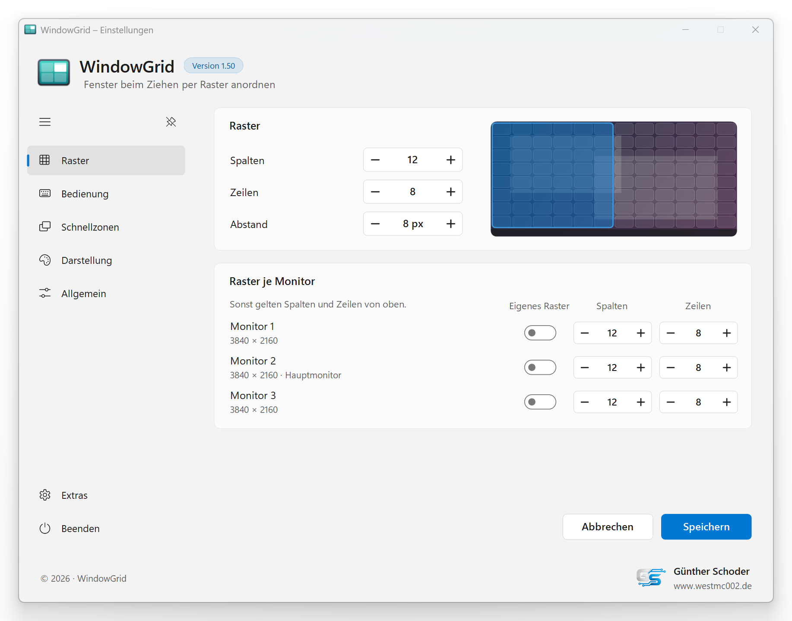</td>
    <td>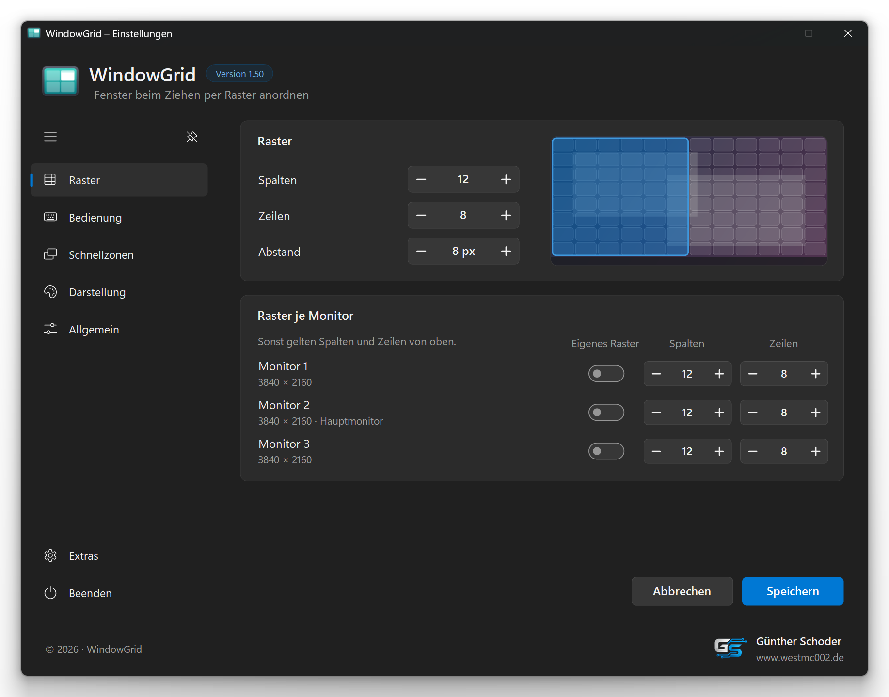</td>
  </tr>
  <tr>
    <td align="center">Light · Hell</td>
    <td align="center">Dark · Dunkel</td>
  </tr>
</table>

Author / Autor: Günther Schoder · [www.westmc002.de](https://www.westmc002.de)

---

## English

Arrange windows on a grid while dragging them – a modern remake of the classic WindowGrid idea for Windows 10 and 11. Drag a window by its title bar, press **Space**, and a grid appears on the monitor. Select the cells the window should cover and release the mouse button – the window fills exactly that area.

The program interface is in German.

### Features

- **Resize on the grid:** hold Space, move to the start cell, release Space, then drag out the size – the selection is shown in the Windows accent color with its size in pixels and cells
- **Move on the grid:** press Ctrl while dragging – the window keeps its size and snaps to the grid lines
- **Free cells to the screen edge:** dashed measuring lines show how many cells are free on each side; equal margins are highlighted
- **Center** with one key (default C)
- **Finer or coarser grid** with the mouse wheel (from 1/16 to 4 ×)
- **Quick zones 1–9:** jump to a stored area with a digit key, Shift+digit saves the current selection; editor with preview
- **Quick zones without the mouse:** Ctrl+Win+Alt+1–9 moves the active window to a quick zone
- **Grid per monitor:** individual columns and rows for each monitor
- **Exceptions:** programs in which WindowGrid stays out of the way
- **Fine-tuning with the arrow keys**
- **Repeat the last selection:** press Space twice quickly
- **All keys freely assignable**
- Works on **multiple monitors** and with **per-monitor DPI scaling**
- **Tray icon** with a Windows 11 style menu, light/dark mode and Windows accent color
- **Autostart**, optionally **with administrator rights** (via Task Scheduler) to arrange windows of elevated programs
- **Updates:** checks GitHub for a new version at startup (at most once a day) and updates itself with one click (download verified by SHA-256) – settings are kept
- **Export/import** of the settings, e.g. for a second PC
- **No installation:** extract and start – settings are stored in `%LOCALAPPDATA%\WindowGrid\WindowGrid.ini`

### Installation

1. Download the ZIP `WindowGrid-<version>.zip` from the [Releases](https://github.com/WestMc002/WindowGrid/releases).
2. Extract it into a folder of its own with write access (e.g. `C:\Tools\WindowGrid`) and start `WindowGrid.exe` – no installation required. Settings are stored in `%LOCALAPPDATA%\WindowGrid\WindowGrid.ini`.
3. Optional: enable “Mit Windows starten” (start with Windows) in the settings.

Requirements: Windows 10 or 11 with .NET Framework 4.x (included in Windows).

Tip for Windows 11: turn off the snap layouts at the top of the screen (Settings › System › Multitasking) so they don't overlap the grid. The settings window has a button for this.

### Building from source

Run `Erstellen.bat` in the project folder. It

- compiles with the C# compiler of .NET Framework 4 (no other software needed),
- assigns the version number automatically (Major.Minor.Year.MonthDay),
- keeps the previous EXE and backs up the project to `Backup`,
- starts the new WindowGrid.

---

## Deutsch

Fenster beim Ziehen per Raster anordnen – ein moderner Nachbau der bekannten WindowGrid-Idee für Windows 10 und 11. Ein Fenster an der Titelleiste ziehen, die **Leertaste** drücken, und auf dem Monitor erscheint ein Raster. Die Felder markieren, die das Fenster einnehmen soll, und die Maustaste loslassen – das Fenster füllt genau diesen Bereich.

### Funktionen

- **Größe im Raster:** Leertaste halten, zum Startfeld fahren, Leertaste loslassen, dann die Größe aufziehen – die Auswahl erscheint in der Windows-Akzentfarbe mit Größe in Pixeln und Feldern
- **Verschieben im Raster:** beim Ziehen Strg drücken – das Fenster behält seine Größe und rastet an den Rasterlinien ein
- **Freie Felder zum Rand:** gestrichelte Maßlinien zeigen, wie viele Felder auf jeder Seite frei sind; gleiche Abstände werden hervorgehoben
- **Zentrieren** mit einer Taste (Standard C)
- **Raster feiner oder gröber** mit dem Mausrad (1/16 bis 4-fach)
- **Schnellzonen 1–9:** mit einer Ziffer auf einen gespeicherten Bereich springen, Umschalt+Ziffer speichert die aktuelle Auswahl; Editor mit Vorschau
- **Schnellzonen ohne Maus:** Strg+Win+Alt+1–9 setzt das aktive Fenster auf eine Schnellzone
- **Raster je Monitor:** eigene Spalten und Zeilen für jeden Monitor
- **Ausnahmen:** Programme, bei denen WindowGrid nichts tut
- **Feinjustieren mit den Pfeiltasten**
- **Letzte Auswahl wiederholen:** Leertaste zweimal schnell drücken
- **Alle Tasten frei belegbar**
- Funktioniert mit **mehreren Monitoren** und **unterschiedlicher Skalierung je Monitor**
- **Tray-Symbol** mit Menü im Windows-11-Stil, Hell/Dunkel und Windows-Akzentfarbe
- **Autostart**, wahlweise **mit Administratorrechten** (über die Aufgabenplanung), um auch Fenster von Programmen mit Adminrechten anzuordnen
- **Updates:** sieht beim Start (höchstens einmal täglich) auf GitHub nach einer neuen Version und aktualisiert sich auf Klick selbst (Download per SHA-256 geprüft) – die Einstellungen bleiben erhalten
- **Export/Import** der Einstellungen, z. B. für einen zweiten Rechner
- **Ohne Installation:** entpacken und starten – die Einstellungen liegen in `%LOCALAPPDATA%\WindowGrid\WindowGrid.ini`

Die ausführliche Anleitung steht in [Anleitung.txt](Anleitung.txt).

### Installation

1. Das ZIP `WindowGrid-<Version>.zip` aus den [Releases](https://github.com/WestMc002/WindowGrid/releases) herunterladen.
2. In einen eigenen Ordner mit Schreibrechten entpacken (z. B. `C:\Tools\WindowGrid`) und `WindowGrid.exe` starten – keine Installation nötig. Die Einstellungen landen in `%LOCALAPPDATA%\WindowGrid\WindowGrid.ini`.
3. Optional: in den Einstellungen „Mit Windows starten“ einschalten.

Voraussetzungen: Windows 10 oder 11 mit .NET Framework 4.x (in Windows enthalten).

Tipp für Windows 11: die Andocklayouts am oberen Bildschirmrand ausschalten (Einstellungen › System › Multitasking), damit sie sich nicht mit dem Raster überlagern. Im Einstellungsfenster gibt es dafür einen Knopf.

### Selbst kompilieren

`Erstellen.bat` im Projektordner starten. Sie

- kompiliert mit dem C#-Compiler des .NET Framework 4 (keine weitere Software nötig),
- vergibt die Versionsnummer automatisch (Haupt.Neben.Jahr.MonatTag),
- bewahrt die bisherige EXE auf und sichert das Projekt unter `Backup`,
- startet das neue WindowGrid.

---

## Screenshots

<table>
  <tr>
    <td>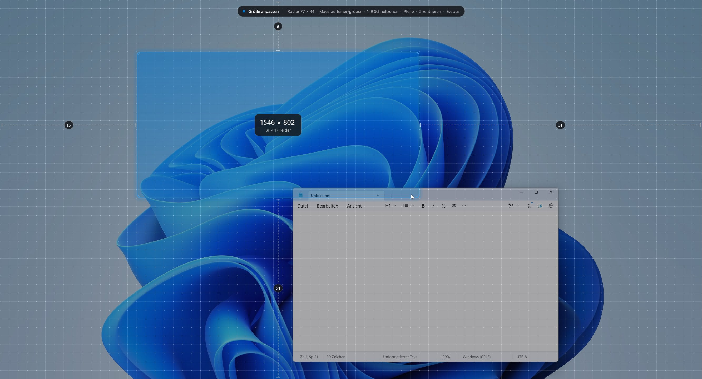</td>
    <td>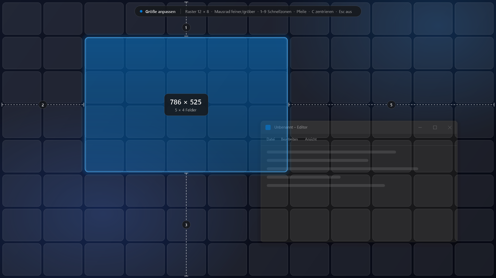</td>
  </tr>
  <tr><td colspan="2" align="center">Resizing on the grid · Größe im Raster anpassen</td></tr>
  <tr>
    <td>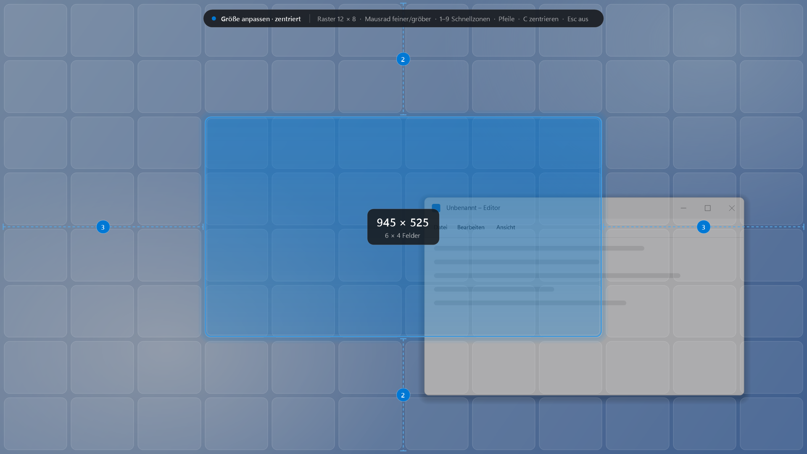</td>
    <td>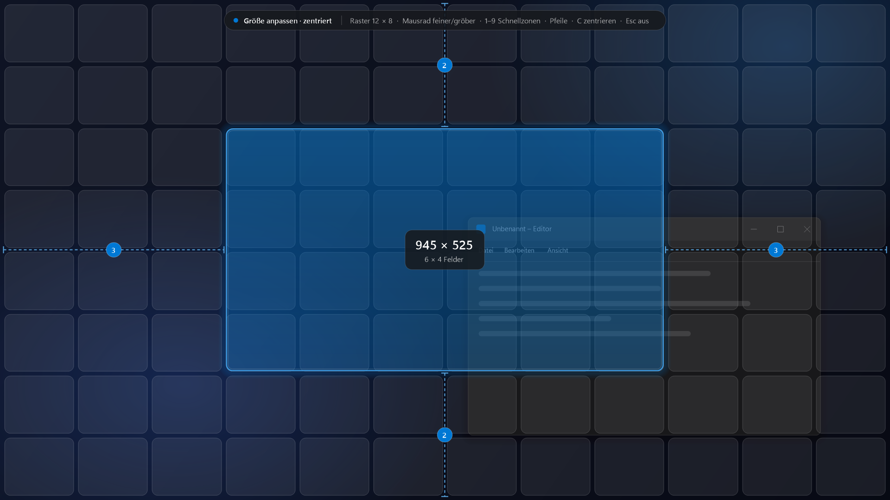</td>
  </tr>
  <tr><td colspan="2" align="center">Centered, equal margins highlighted · Zentriert, gleiche Abstände hervorgehoben</td></tr>
  <tr>
    <td>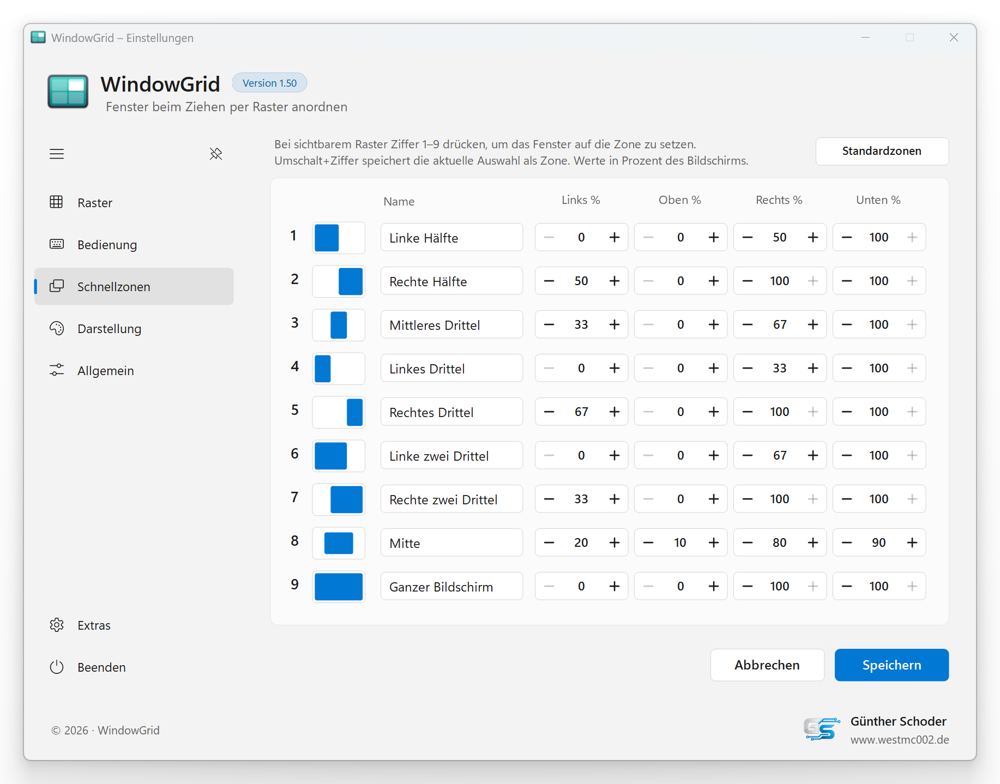</td>
    <td>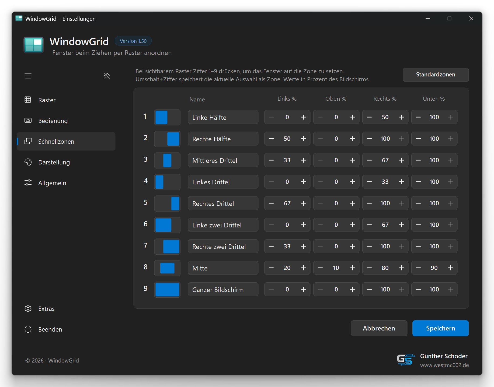</td>
  </tr>
  <tr><td colspan="2" align="center">Quick zone editor · Schnellzonen bearbeiten</td></tr>
  <tr>
    <td>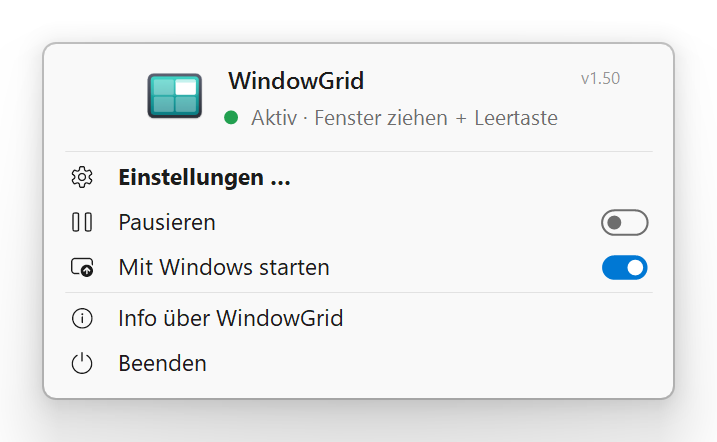</td>
    <td>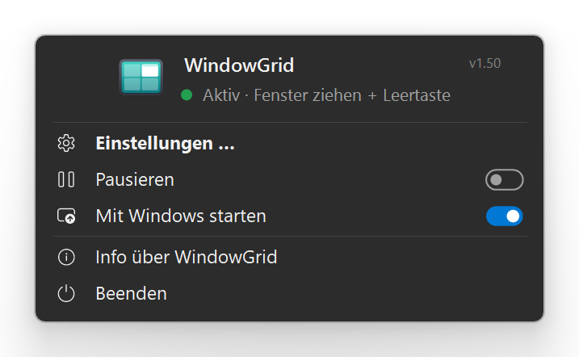</td>
  </tr>
  <tr><td colspan="2" align="center">Tray menu · Tray-Menü</td></tr>
  <tr>
    <td>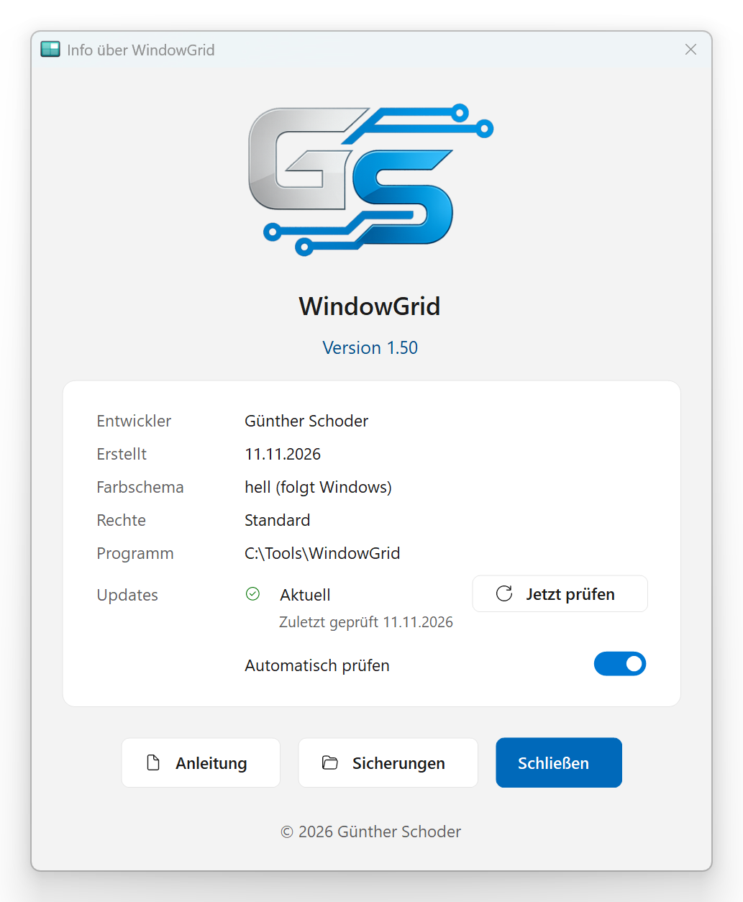</td>
    <td>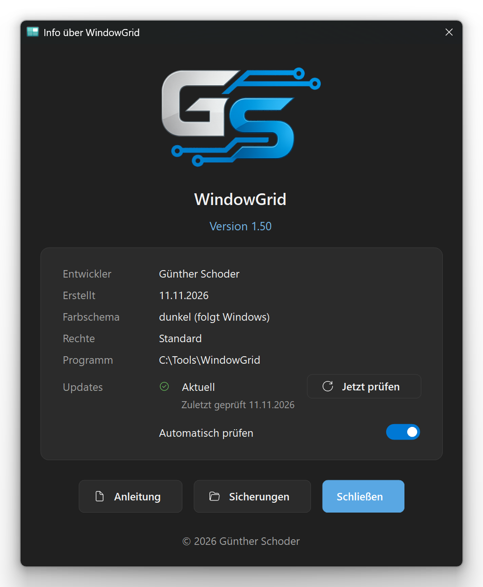</td>
  </tr>
  <tr><td colspan="2" align="center">About WindowGrid · Info über WindowGrid</td></tr>
</table>

## Project structure / Projektaufbau

| Folder / file · Ordner / Datei | Content · Inhalt |
|---|---|
| `Quellcode` | C# source code and manifest · C#-Quellcode und Manifest |
| `Resources` | embedded resources (icon, logo) · eingebettete Ressourcen (Icon, Logo) |
| `Screenshots` | images for this page · Bilder für diese Seite |
| `Erstellen.bat` | build script · Build-Skript |
| `Anleitung.txt` | manual (German) · Anleitung (Deutsch) |

## License / Lizenz

GNU General Public License v3.0 or later · GNU General Public License v3.0 oder später – [LICENSE](LICENSE).

© 2026 Günther Schoder

**Exception / Ausnahme:** The GS logo (`Resources/GS-Logo.png`) is excluded from the GPL. All rights reserved; it may only be redistributed unchanged together with this program. · Das GS-Logo (`Resources/GS-Logo.png`) ist von der GPL ausgenommen. Alle Rechte vorbehalten; es darf nur zusammen mit diesem Programm in unveränderter Form weitergegeben werden.

This project is an independent remake inspired by the freeware WindowGrid (2016). It contains no code from it and is not affiliated with its author. · Dieses Projekt ist ein unabhängiger Nachbau, angeregt durch die Freeware WindowGrid (2016). Es enthält keinen Code daraus und ist nicht mit deren Autor verbunden.

This project is not affiliated with or endorsed by Microsoft; Windows is a trademark of Microsoft Corporation. · Dieses Projekt ist nicht mit Microsoft verbunden und wird nicht von Microsoft unterstützt; Windows ist eine Marke der Microsoft Corporation.
